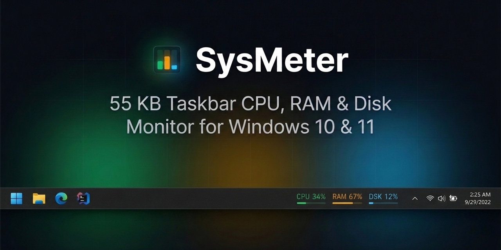

# SysMeter



**A lightweight, ultra-clean real-time CPU, RAM & Disk usage monitor for the Windows 10 and Windows 11 taskbar.**

[](https://github.com/grafigrow/SysMeter/releases)
[](https://github.com/grafigrow/SysMeter)
[](LICENSE)
[](https://github.com/grafigrow/SysMeter/releases)
[](https://github.com/grafigrow/SysMeter/releases)

> **Zero bloat. Zero dependencies. ~55 KB binary.**  
> Stop opening Task Manager ten times a day just to check why your PC is slow. SysMeter sits quietly on your Windows 10/11 taskbar showing live **CPU %**, **RAM % (with GB used)**, and **Disk %**, with color-coded thresholds, daily peak history, and CSV export.


---

## Why SysMeter?

- **Live CPU, RAM & Disk %** — Color-coded automatically: 🟢 Green (0–50%), 🟡 Amber (51–80%), 🔴 Red (81–100%).
- **Taskbar Snap & Always-on-Top** — Snaps cleanly next to the Windows 10/11 system tray and survives `Win+D` and Explorer restarts.
- **Per-Monitor High-DPI Crispness** — Scales cleanly on 100%, 125%, 150%, 175%, and 200% laptop displays.
- **Two Layout Styles** — Switch between **Two-Line Stacked** and **Single-Line Horizontal** from the right-click menu.
- **Dynamic System Tray Icon** — Shows live CPU % right in the system tray.
- **Daily Peak History & CSV Export** — Double-click the widget to view daily peak & average CPU/RAM/Disk usage and export `.csv` reports.
- **Midnight Daily Summary Pop-up** — Clean dark-mode summary card at midnight.
- **Zero Admin Rights Required** — Uses standard Windows APIs (`GetSystemTimes`, `GlobalMemoryStatusEx`) with ~5 MB RAM footprint.

---

## Download & Install

| Option | Best For | Link |
| :--- | :--- | :--- |
| **Windows Installer (`.exe`)** | Most users (Desktop shortcut, Start with Windows, clean uninstaller) | [Download Latest Setup.exe](https://github.com/grafigrow/SysMeter/releases/latest) |
| **Portable ZIP (`.zip`)** | USB drives / no installation | [Download Portable ZIP](https://github.com/grafigrow/SysMeter/releases/latest) |

---

## Companion Tool

Looking for live **Download & Upload speeds** on your taskbar too?  
Check out **[NetSpeedMeter](https://github.com/grafigrow/NetSpeedMeter)** — built with the same ultra-lightweight architecture by GrafiGrow.

---

## Build from Source

No Visual Studio or external packages required — compiles with the built-in .NET Framework 4.x `csc.exe` on any Windows 10/11 machine:

```powershell
.\scripts\build.ps1
.\scripts\test.ps1
```

---

## License

MIT License © 2026 [Mustafizur Rahman (GrafiGrow)](https://grafigrow.vercel.app)
